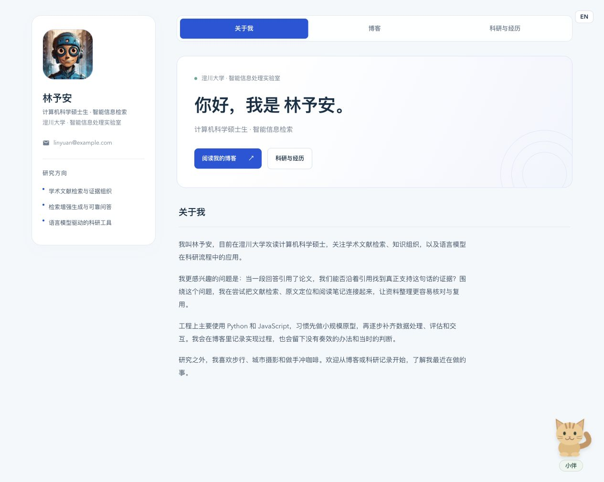
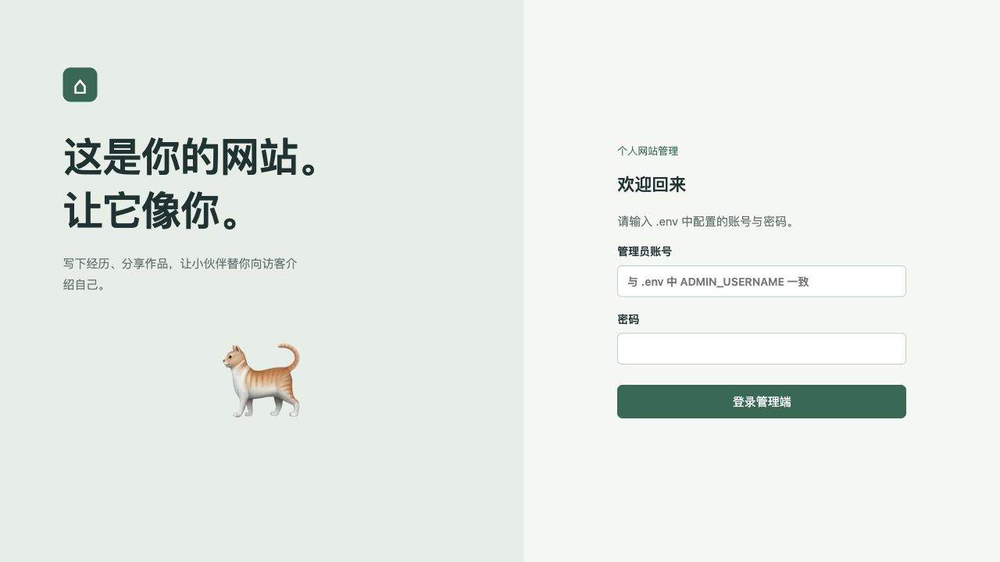
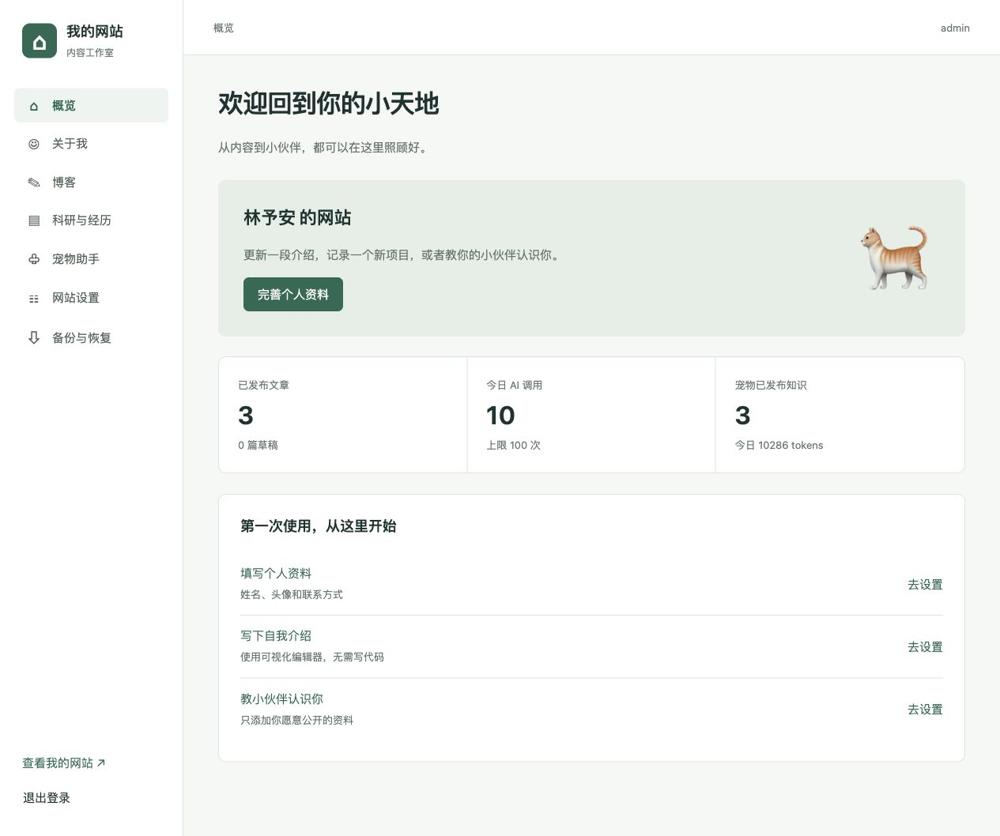
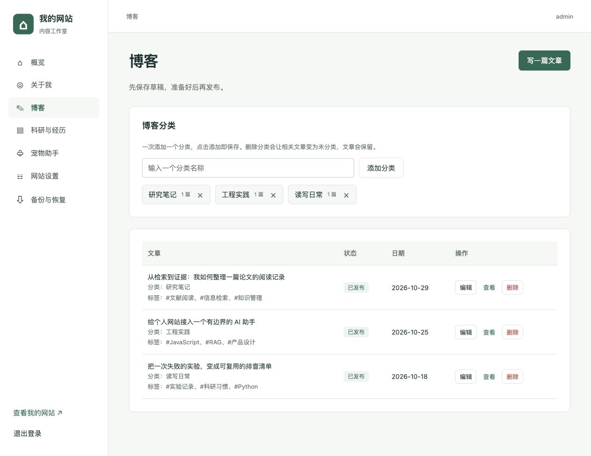
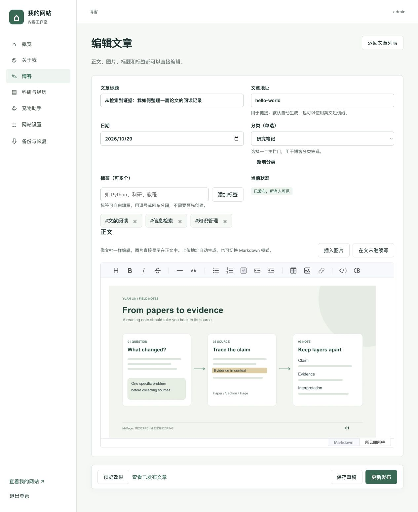
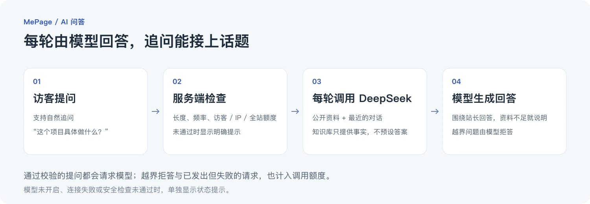
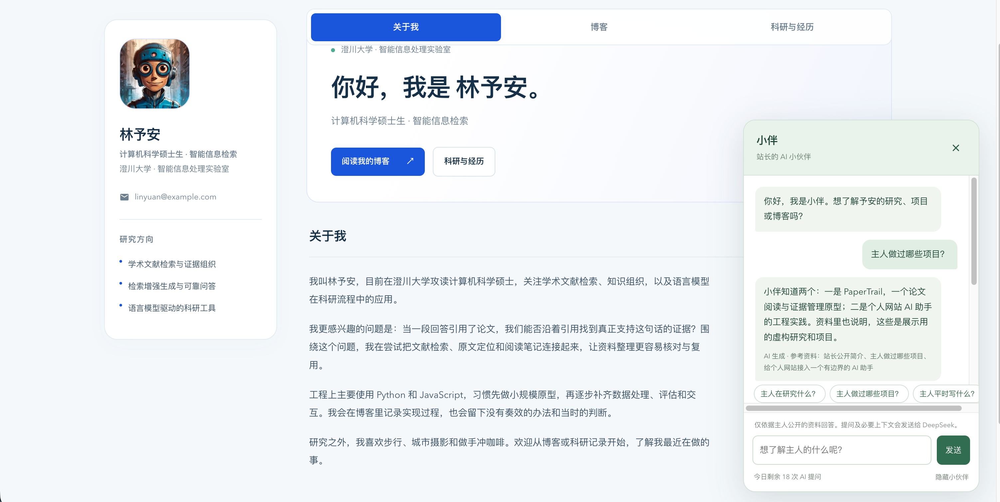

# MePage
[English](README_EN.md)

**一个极简、易部署的个人网站，带 AI 助手，用来展示个人经历、作品集与博客。**

装好 Node.js 24 LTS，下载项目，按下面的命令安装并启动，就能运行自己的个人网站。项目自带示例配置和演示内容，无需单独安装数据库，适合想搭建个人主页的学生、研究者和开发者。

网站运行后，改简介、发文章、插图片和更新项目记录都在网页后台完成，日常维护不需要写代码。




*截图使用虚构演示资料；姓名、头像、简介和主题色均可在后台替换。*

## 能做什么

| 功能 | 使用方式 |
| --- | --- |
| 个人主页 | 中英文介绍、头像、研究方向、联系方式和主题色，均可在网页修改 |
| 博客 | 接近 Word 的可视化编辑，也支持 Markdown；图片可上传、粘贴或拖入正文 |
| 内容整理 | 草稿与发布分开，分类在博客中逐项添加，标签随文章自由填写 |
| 科研与经历 | 集中展示论文、奖项、教育和项目经历 |
| AI 小伙伴 | 可选猫或狗，接入 DeepSeek，结合公开资料和对话回答访客问题 |
| 自己保存数据 | 网站资料、文章、知识库和图片统一保存在 SQLite，无需额外安装数据库服务 |

不配置 AI，也能正常使用主页和博客。项目自带的演示内容可以在后台替换，其中的人物、学校与科研记录均为虚构。

## 本地运行

需要 **Node.js 24 LTS**。

```bash
git clone https://github.com/JiangYuxin-Jim/MePage.git
cd MePage
npm ci
cp .env.example .env
cp config.example.json config.json
npm start
```

| 入口 | 默认地址 |
| --- | --- |
| 网站前台 | http://localhost:18731 |
| 网页后台 | http://127.0.0.1:18732 |
| 初始账号 / 密码 | `admin` / `admin` |

账号和密码在 `.env` 中设置，均不能为空，密码没有最小长度要求。公网部署前请修改初始密码。`npm start` 会先构建编辑器，再启动前后台；按 `Ctrl+C` 停止。

登录后，可以从“关于我”“博客”“科研与经历”分别修改资料、管理文章和补充经历。写文章、插图和发布的步骤见[后台使用图解](#后台使用图解)。

## 服务器部署与 PM2 保活

在服务器上安装 Node.js 24 LTS，执行上面的克隆、安装和复制配置步骤。

先修改 `.env` 中的初始账号密码，再将 `config.json` 的 `server` 部分改为：

```json
{
  "port": 18731,
  "adminPort": 18732,
  "host": "0.0.0.0",
  "adminHost": "0.0.0.0",
  "publicUrl": "http://你的服务器IP:18731",
  "adminUrl": "http://你的服务器IP:18732",
  "trustProxy": false,
  "trustedProxies": ["loopback"]
}
```

这里只修改 `server`，保留原有的 `ai` 和 `limits`。管理端默认仅允许本机访问，将 `adminHost` 设为 `0.0.0.0` 后，才能通过服务器 IP 访问。

在服务器防火墙和云平台安全组中放行所选端口，然后启动 PM2：

```bash
npm run build
npm install -g pm2
pm2 start app.js --name mepage
pm2 startup
# 按终端提示执行生成的开机启动命令
pm2 save
```

前后台在同一个进程中运行，PM2 使用单实例即可。浏览器打开 `http://服务器IP:18731` 查看网站，打开 `http://服务器IP:18732` 登录后台。

```bash
pm2 logs mepage       # 查看日志
pm2 restart mepage    # 重启前后台
pm2 stop mepage       # 停止前后台
```

使用域名时，可用 Nginx 等反向代理分别转发前台和后台端口，配置 HTTPS，并把两个入口 URL 改为实际域名。需要获取代理后的访客 IP 时，启用 `trustProxy`，并在 `trustedProxies` 中填写实际可信代理地址。

更新代码后，在项目目录执行 `npm ci`、`npm run build`、`pm2 restart mepage`。

## 配置放在哪里

日常内容在网页后台修改，部署参数放在本地配置文件中。

| 位置 | 保存内容 | 修改方式 |
| --- | --- | --- |
| `.env` | 管理账号、密码、DeepSeek API Key | 修改本地文件 |
| `config.json` | 访问地址、端口、模型参数、调用限额 | 修改本地文件 |
| `data/site.sqlite` | 个人资料、文章、分类、科研经历、知识库、图片，以及登录会话和调用计数 | 网页后台自动保存 |
| `assets/demo/` | 首次启动导入 SQLite 的演示配图 | 日常上传的图片直接存入数据库 |

`.env` 示例：

```dotenv
ADMIN_USERNAME=admin
ADMIN_PASSWORD=请换成你自己的密码
DEEPSEEK_API_KEY=
```

账号密码只从 `.env` 读取，不保存到 SQLite。网页后台保存的内容立即生效，无需再维护一份 Markdown 或 JSON 内容文件；修改监听地址或端口后则需要重启服务。

Git 和 Docker 构建会忽略真实 `.env`、本地 `config.json`、数据库及运行日志。仓库提供的示例文件是 `.env.example` 和 `config.example.json`。

## 后台使用图解

### 1. 登录，找到内容入口

本地打开 `http://127.0.0.1:18732`，使用 `.env` 中的账号密码登录。示例配置为 `admin` / `admin`，修改后以自己的配置为准。

从左侧导航可以进入个人资料、博客、科研经历和宠物助手。先替换演示资料，再开始发文章。

<details>
<summary>查看登录页与后台概览</summary>





</details>

### 2. 在“博客”里添加分类

输入分类名称，点击“添加分类”即可保存。下方文章列表会标出草稿和已发布状态，也可以在这里编辑或查看文章。写新文章时，点击右上角“写一篇文章”。



### 3. 写正文，直接插入图片

填好标题、选好分类，就可以像写文档一样输入正文、添加标题和列表。文章地址会自动生成，保留默认值即可。

每篇文章选择一个分类；标签可以填多个，用逗号或回车分隔，无需提前创建。

点击“插入图片”选择本地图片，或将图片粘贴、拖入正文。编辑器会直接显示图片，并自动生成地址。插图后可继续输入文字，也可以点击“在文末继续写”。支持 PNG、JPEG、WebP，单张最大 5MB；需要 Markdown 时，用编辑器下方的按钮切换。



*图中是已有文章的编辑页；首次发布时，右下角按钮显示“发布文章”，已发布文章则显示“更新发布”。*

### 4. 预览，再保存或发布

| 操作 | 结果 |
| --- | --- |
| 预览效果 | 查看当前正文的渲染效果，不会发布 |
| 保存草稿 | 保存为仅自己可见的文章，稍后可从博客列表继续编辑 |
| 发布文章 | 让访客在前台博客中阅读 |
| 更新发布 | 保存已发布文章的修改，前台同步更新 |
| 查看已发布文章 | 打开前台页面，确认最终效果 |

对已发布文章点击“保存草稿”，会在确认后将其从前台撤下。打开编辑器或预览文章不会改变线上内容。

## AI 小伙伴如何回答

在 `.env` 填入 `DEEPSEEK_API_KEY`，将 `config.json` 的 `ai.enabled` 改为 `true`，然后在后台整理、发布知识库。模型和回答长度等参数在 `config.json` 的 `ai` 中设置。



每轮通过长度、频率和额度检查的提问，都会请求 DeepSeek。知识库只提供事实，不预设答案，也不缓存固定问答。




- 资料来自公开简介、已发布知识库、可见的科研经历与已发布博客；未发布内容不会作为资料发送。
- 每次请求会带上服务端保存的最近三轮对话。例如先问“主人做过哪些项目”，再追问“这个项目具体做什么”；指代不清时，要求模型澄清。
- 模型应围绕站长回答，资料没有记载的细节需说明不足。无关问题和越界请求有相应的拒答规则。
- 模型未开启、连接失败或输出未通过安全检查时，界面会显示相应提示，不会用预设答案替代。成功回复标注“AI 生成”。

匿名访客无需注册。调用限制由服务端执行，配置位于 `config.json` 的 `limits`：

| 参数 | 默认值 | 作用 |
| --- | --- | --- |
| `visitorDaily` | 10 | 每个浏览器访客每日上限 |
| `ipDaily` | 30 | 每个 IP 每日上限 |
| `siteDaily` | 100 | 全站每日上限 |
| `perMinute` | 5 | 每个访客和 IP 每分钟上限 |
| `concurrent` | 2 | 全站同时请求模型的上限，同一访客同时只能发一个问题 |
| `questionLength` | 500 | 单次提问字符上限 |
| `timezone` | `Asia/Shanghai` | 每日额度的日期划分时区 |

模型的越界拒答也计入调用次数。请求一旦发给供应商，即使失败或超时也会计数，重试仍需消耗额度。模型调用费用由部署者承担。

## 内容导出与演示重置

后台支持导出和恢复网站内容，包括图片。账号密码、API Key、部署参数、访客会话与调用额度不会导出。恢复会替换当前网站内容。

需要重新载入演示内容时，先停止服务，再执行：

```bash
npm run seed:demo
```

这会覆盖网站内容和图片，不创建备份；账号、密钥与调用计数保持不变。

## Docker（可选）

先复制并编辑两份示例配置，再执行：

```bash
docker compose up -d --build
# 停止：docker compose stop
```

Docker 默认使用前述两个端口。修改 `config.json` 中的端口时，也要同步修改 `compose.yaml` 的端口映射。数据保存在 Docker 命名卷中，`.env` 和 `config.json` 从本机以只读方式挂载；Compose 将容器内的监听地址设为 `0.0.0.0`。
