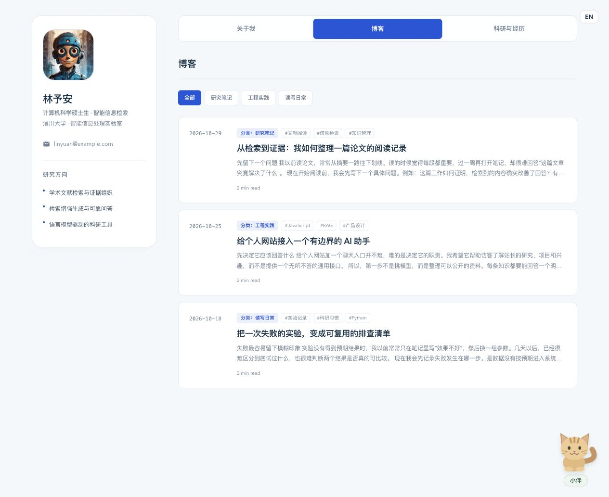

# MePage

**A minimal personal website with an optional AI assistant, easy to deploy and maintain.**

Install Node.js 24 LTS, download the project, and run the commands below. The project includes example configuration and demo content, with no separate database server to install.

Use it for your profile, portfolio, blog and research. After deployment, you can edit text, insert images and publish posts in the browser admin without writing code.

[GitHub](https://github.com/JiangYuxin-Jim/MePage) · [中文](README.md)


*Screenshots use fictional demo content. Replace the profile, avatar and theme in the admin.*

- Bilingual profile, research timeline and customizable accent color.
- Visual blog editor with optional Markdown, image upload/paste/drag, drafts, publishing and categories.
- Optional cat or dog companion using DeepSeek and your public knowledge base, with scope checks and visitor/IP/site quotas.
- SQLite stores content, settings and image bytes. No separate database server needed; content export and restore are available in the admin.

The demo people, institutions and research records are fictional and can be replaced in the admin. The profile and blog also work without AI.

## Run locally

Requires **Node.js 24 LTS**.

```bash
git clone https://github.com/JiangYuxin-Jim/MePage.git
cd MePage
npm ci
cp .env.example .env
cp config.example.json config.json
npm start
```

The website is at <http://localhost:18731> and the admin at <http://127.0.0.1:18732>. The initial username and password are `admin` / `admin`; change them in `.env`. Neither field can be empty, but there is no minimum password length. Press `Ctrl+C` to stop.

After signing in, replace the profile and About text, add blog categories, and publish your first article. Upload, paste or drag PNG/JPEG/WebP images into the editor (up to 5MB each); image URLs are created automatically. Update research records and enable the AI companion only if needed.



## Deploy on a server

Install Node.js 24 LTS, then clone the project, install dependencies and copy the example files as shown above. Change the credentials in `.env`. In the `server` section of `config.json`, set `adminHost` to `0.0.0.0`, and set `publicUrl` and `adminUrl` to `http://YOUR_SERVER_IP:18731` and `http://YOUR_SERVER_IP:18732`. Open the selected ports in your firewall and security group.

```bash
npm run build
npm install -g pm2
pm2 start app.js --name mepage
pm2 startup
# Run the startup command printed by PM2, then:
pm2 save
```

Visit the public site and admin using your server IP and their respective ports.

```bash
pm2 logs mepage
pm2 restart mepage
pm2 stop mepage
```

For public hosting, configure a domain and HTTPS reverse proxy to the two ports, then update the two URLs. Enable `trustProxy` only when needed, and list the actual proxy addresses in `trustedProxies`.

One PM2 process serves both ports; use a single instance. After an update, run `npm ci`, `npm run build` and `pm2 restart mepage` in the project directory.

## Configuration

| Location | Purpose |
| --- | --- |
| `.env` | `ADMIN_USERNAME`, `ADMIN_PASSWORD`, `DEEPSEEK_API_KEY`; the sole source of login credentials |
| `config.json` | `server` ports/addresses, `ai` model settings, `limits` quotas and frequency |
| `data/site.sqlite` | Profile, posts, categories, research, knowledge, images, sessions and usage |
| `assets/demo/` | Initial demo images imported into SQLite; uploads go directly to SQLite |

To enable AI, add your key, set `ai.enabled` to `true`, and publish knowledge entries in the admin. Every question that passes input, rate and quota checks calls the model with recent conversation context. Knowledge entries provide facts, not preset replies. The model is instructed to refuse questions outside its role of introducing the site owner; refusals also count toward quotas. The deployer pays for model calls. Anonymous visitors are subject to browser identifier, IP and site-wide quotas.

Restart after changing listening addresses or ports. Browser content changes apply immediately. Real `.env`, local `config.json` and `data/` are ignored by Git and Docker builds. Content exports exclude credentials, API keys, deployment settings and usage. Restoring replaces current content.

To reset demo content, stop the app and run `npm run seed:demo`. This replaces content and images without making a backup.

## Publish your first blog post

1. Open the admin address and sign in with the credentials from `.env`. The example defaults are `admin` / `admin`.
2. Open Blog, enter a category name and click Add. Click Write an article in the upper-right corner to start a post.


3. Enter a title, select one category, and write in the visual editor. The article URL is generated automatically. Tags are optional and can be entered freely, separated by commas or Enter.
4. Click Insert image to choose a file, or paste or drag an image into the body. The editor displays it and creates its URL automatically. PNG/JPEG/WebP files up to 5MB are supported. Use Continue writing at the end to resume typing, or switch to Markdown mode if you prefer.


*This screenshot shows an existing post. For a new post, the bottom-right action is Publish; for an already published post, it is Update publication.*

5. Preview the body, save it as a private draft, or publish it. Click View published article to check the public page. Saving an already published post as a draft removes it from the public site after confirmation. Opening the editor or previewing a post does not change the published content.

<details>
<summary>Login screen and admin overview</summary>


</details>

## AI conversations and limits


The model receives relevant public profile data, published knowledge, visible research records and published posts, along with up to three recent conversation turns. Visitors can ask follow-up questions about a project without repeating the owner's name. The model is instructed to clarify ambiguous references and acknowledge missing information without inventing details. Knowledge entries do not contain preset replies.

The assistant has rules for refusing unrelated tasks, prompt injection and requests for private information. Successful replies are labelled as AI generated. If AI is disabled, the provider fails, or the output fails a safety check, the interface displays a status notice.

| `limits` setting | Default | Purpose |
| --- | --- | --- |
| `visitorDaily` | 10 | Daily requests per browser visitor |
| `ipDaily` | 30 | Daily requests per IP |
| `siteDaily` | 100 | Daily requests across the site |
| `perMinute` | 5 | Requests per minute per visitor and IP |
| `concurrent` | 2 | Site-wide concurrent model calls; one per visitor at a time |
| `questionLength` | 500 | Characters per question |
| `timezone` | `Asia/Shanghai` | Day boundary for daily quotas |

Model refusals count toward quotas, as do requests sent to the provider that fail or time out. The server checks input, request frequency and quotas.

## Docker (optional)

Copy and edit the example configuration files first:

```bash
docker compose up -d --build
# Stop: docker compose stop
```

If you change ports in `config.json`, update the Compose port mappings too. Data persists in a named volume; `.env` and `config.json` are mounted read-only. Compose sets container listening addresses to `0.0.0.0`.
